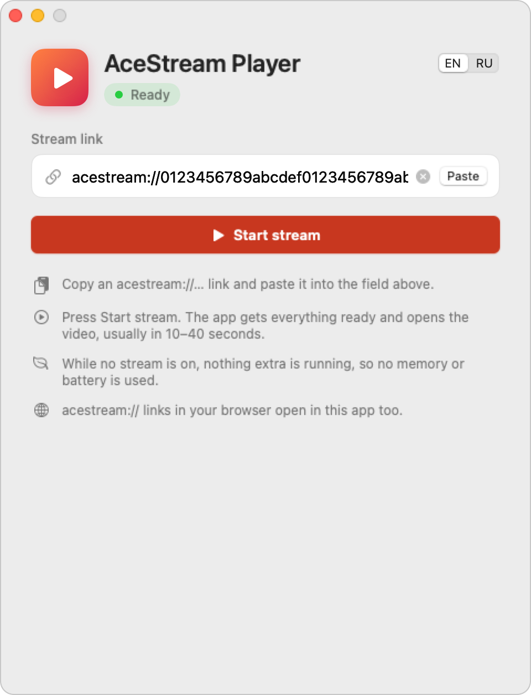

# AceStream Player for macOS

English | [Русский](README.ru.md)

<p align="center">
  <picture>
    <source media="(prefers-color-scheme: dark)" srcset="docs/screenshot-en-dark.png">
    
  </picture>
</p>

Watch Ace Stream on a Mac without setting anything up or figuring anything out.

- **Setup is one button.** On first launch you pick a language and press "Install and set up". The app downloads and installs everything it needs by itself.
- **Watching is one click.** Paste an `acestream://` link and press "Start stream". The app starts everything in the background and opens the video.
- **Stopping is one click.** Press "Stop" and everything shuts down, so nothing keeps running and eating memory or battery.

No terminal, no settings, nothing to understand. Under the hood it runs the Ace Stream engine in Docker Desktop and plays the video in IINA, but you never have to deal with either.

Needs an Apple Silicon Mac (M1 or newer) with macOS 14 or later and about 4 GB of free space.

The app is in English and Russian. It asks which one on first launch; you can switch any time in settings (the gear in the top-right corner).

## Install

1. Download `AceStreamPlayer.dmg` from [Releases](https://github.com/teecil/acestream-player-mac/releases/latest) and drag the app into Applications.
2. The app isn't signed with a paid Apple developer certificate, so macOS won't open it the first time. Go to System Settings → Privacy & Security, scroll down and click "Open Anyway".
3. Pick a language, then press "Install and set up". The app downloads IINA and Docker Desktop, about 1 GB, and asks for your Mac password once to install Docker. This takes 5–10 minutes and only happens once.

## Use

- Paste a link and press "Start stream". It takes 10–40 seconds, mostly waiting for Docker to boot.
- If you want other stream, paste another link and press "Open". The current stream keeps playing until the new one actually starts. If the new one fails, you stay on the old one.
- Press "Stop" when you're done. The player closes and Docker shuts down, so nothing keeps running in the background. Quitting the app does the same.
- `acestream://` links clicked in a browser open in the app.

If something goes wrong, the log is at `~/Library/Logs/AceStreamPlayer/AceStreamPlayer.log` (Help → Show Log).

## Updates

The app doesn't check for updates on its own unless you ask it to. In settings (the gear) you can press "Check for updates" or turn on "Check for updates automatically"; then it checks on launch and shows a small banner when a new version is out. To update, download the new DMG and drag the app into Applications again. Your settings, Docker and IINA stay as they are.

## Uninstall

Settings (the gear) → Uninstall. By default it removes everything: IINA, Docker Desktop with all its data, and the app itself with its settings. After that the Mac is clean and you can install from scratch. If you want to keep something (say you like IINA or use Docker for other things), tick "I want to keep something" and untick it. Without all three parts the app won't work.

## How it works

- **Engine.** Ace Stream has no official Docker image, and their Linux engine only exists for x86_64. The app uses `jopsis/acestream:v3.2.17-fix`, pinned by digest so it can't change under you. It has an arm64 build of the engine, so it runs without emulation. If that one won't start, it falls back to Ace Link's `blaiseio/acelink` image (amd64, emulated) and remembers which one worked.
- **Docker Desktop** comes from docker.com and is installed with Docker's own unattended installer (`install --accept-license --user=…`). It only runs while you're watching. For the copy the app installed, start-at-login and the dashboard pop-up are turned off. A Docker Desktop you installed and started yourself is left alone.
- **IINA** comes from its GitHub releases. The app launches its own IINA process, so Stop never closes IINA windows you opened yourself.
- Before installing anything, the app checks it with Gatekeeper (`spctl --assess`) and makes sure the binary is arm64.
- The engine listens on 127.0.0.1 only, port 16878 or the next free one. Its container has the label `app.acestreamplayer.managed`; the app only ever removes containers with that label and never deletes images. The image is downloaded once (about 100 MB) and reused.
- Switching streams opens the new link as a second session in the same engine and only swaps players once the engine reports it is downloading.
- If the app crashes, a small watchdog script removes the container, closes the player and stops Docker. The next launch cleans up anything left over.

## Build

Needs macOS 14+ and Xcode or the Command Line Tools (`xcode-select --install`).

```bash
swift test
./build.sh     # build/AceStream Player.app, build/AceStreamPlayer.dmg
```

GitHub Actions builds every push on an Apple Silicon runner. Pushing a `v*` tag publishes the DMG to Releases.

To check Docker, the engine image and the engine API without the app:

```bash
scripts/engine_smoke_test.sh               # engine starts and answers
scripts/engine_smoke_test.sh <content-id>  # plus a real stream
```

## Limitations

- The engine image is a community build pinned to one exact build (by digest). To change it, edit `EngineImage` in [DockerService.swift](Sources/AceStreamPlayer/Services/DockerService.swift).
- Starting is slower than it could be, because Docker starts from scratch every time.
- Docker Desktop is free for personal use; the app accepts its license during install.
- To ship without the Gatekeeper warning you'd need a Developer ID certificate and notarization.

## Thanks

Big thanks to [jopsis](https://hub.docker.com/r/jopsis/acestream) for the multi-arch Ace Stream engine image. Without the arm64 build this app would have to run the engine under emulation.
