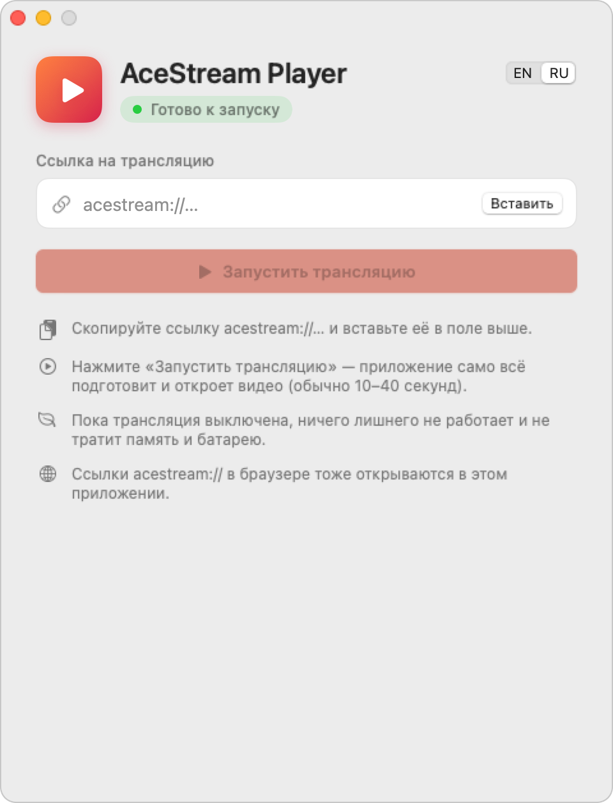

# AceStream Player для macOS

[English](README.md) | Русский

<p align="center">
  <picture>
    <source media="(prefers-color-scheme: dark)" srcset="docs/screenshot-ru-dark.png">
    
  </picture>
</p>

Небольшое приложение для Mac, чтобы смотреть трансляции Ace Stream. Вставляете ссылку `acestream://`, нажимаете «Запустить трансляцию», и видео открывается в IINA. Посмотрели — «Выключить».

Внутри работает движок Ace Stream в Docker Desktop, видео показывает IINA. Оба приложение ставит само при первом запуске, терминал не нужен.

Нужен Mac на Apple Silicon (M1 и новее), macOS 14 или новее и около 8 ГБ свободного места.

Приложение на английском и русском. При первом запуске оно спросит язык, поменять его можно в любой момент переключателем EN | RU в правом верхнем углу окна.

## Установка

1. Скачайте `AceStreamPlayer.dmg` из [Releases](https://github.com/teecil/acestream-player-mac/releases/latest) и перетащите приложение в «Программы».
2. Приложение не подписано платным сертификатом Apple, поэтому в первый раз macOS его не откроет. Зайдите в «Системные настройки» → «Конфиденциальность и безопасность», пролистайте вниз и нажмите «Открыть всё равно».
3. Выберите язык и нажмите «Установить и настроить». Приложение скачает IINA и Docker Desktop (около 1 ГБ) и один раз спросит пароль от Mac, он нужен для установки Docker. Займёт 5–10 минут, и больше это не повторяется.

## Как пользоваться

- Вставьте ссылку и нажмите «Запустить трансляцию». Запуск занимает 10–40 секунд, в основном это ожидание, пока загрузится Docker.
- Если трансляция не работает, вставьте другую ссылку и нажмите «Открыть». Текущая будет идти, пока новая не запустится. Если новая не заработает, останется старая.
- Посмотрели — «Выключить». Плеер закроется, Docker выключится, в фоне ничего не останется. Если просто закрыть приложение, будет то же самое.
- Ссылки `acestream://` из браузера открываются в приложении.

Если что-то сломалось, журнал лежит в `~/Library/Logs/AceStreamPlayer/AceStreamPlayer.log` (меню «Справка» → «Показать журнал работы»).

## Как устроено

- **Движок.** Официального Docker-образа у Ace Stream нет, а Linux-версия движка есть только под x86_64. Поэтому используется `jopsis/acestream:v3.2.17-fix`, закреплённый по отпечатку (digest), чтобы он не мог незаметно поменяться. В нём есть сборка движка под arm64, и он работает без эмуляции. Если он не запустится, приложение попробует образ Ace Link `blaiseio/acelink` (amd64, через эмуляцию) и запомнит, какой сработал.
- **Docker Desktop** скачивается с docker.com и ставится штатным тихим установщиком Docker (`install --accept-license --user=…`). Работает только пока идёт трансляция. В копии, которую поставило приложение, выключены автозапуск при входе и всплывающее окно Docker. Docker, который вы поставили и запустили сами, приложение не трогает.
- **IINA** скачивается из её релизов на GitHub. Приложение запускает свой отдельный процесс IINA, поэтому «Выключить» не закроет окна IINA, которые вы открыли сами.
- Перед установкой всё скачанное проверяется Gatekeeper'ом (`spctl --assess`) и на то, что программа собрана под arm64.
- Движок слушает только 127.0.0.1, порт 16878 или следующий свободный. Контейнер помечен меткой `app.acestreamplayer.managed`; приложение удаляет только контейнеры с этой меткой и никогда не удаляет образы. Образ движка (около 100 МБ) скачивается один раз.
- При переключении новая ссылка открывается второй сессией в том же движке, а плеер меняется только когда движок начал её качать.
- Если приложение упадёт, маленький скрипт-сторож удалит контейнер, закроет плеер и выключит Docker. При следующем запуске приложение подчистит то, что осталось.

## Сборка

Нужны macOS 14+ и Xcode или Command Line Tools (`xcode-select --install`).

```bash
swift test
./build.sh     # build/AceStream Player.app, build/AceStreamPlayer.dmg
```

GitHub Actions собирает каждый push на Mac с Apple Silicon. Тег `v*` выкладывает DMG в Releases.

Проверить Docker, образ и API движка без приложения:

```bash
scripts/engine_smoke_test.sh               # движок запускается и отвечает
scripts/engine_smoke_test.sh <content-id>  # плюс настоящая трансляция
```

## Ограничения

- Образ движка собран сообществом и закреплён на одной конкретной сборке (по отпечатку). Поменять можно в `EngineImage` в [DockerService.swift](Sources/AceStreamPlayer/Services/DockerService.swift).
- Запуск медленнее, чем мог бы быть: Docker каждый раз стартует с нуля.
- Docker Desktop бесплатен для личного использования, его лицензию приложение принимает при установке.
- Чтобы macOS не предупреждала при первом запуске, нужны сертификат Developer ID и нотаризация.

## Спасибо

Большое спасибо [jopsis](https://hub.docker.com/r/jopsis/acestream) за образ движка Ace Stream под разные архитектуры. Без его сборки под arm64 движок пришлось бы запускать через эмуляцию.
